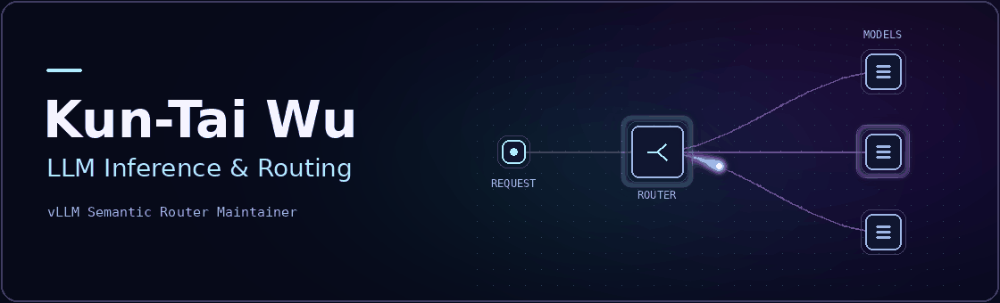

I maintain **vLLM Semantic Router** and build AI developer tools at **Delta Electronics**.

### Selected work

[Semantic Router](https://github.com/vllm-project/semantic-router) · [CUDA on ARM64](https://github.com/vllm-project/semantic-router/pull/5615) · [CUDA Runtime](https://github.com/vllm-project/semantic-router/pull/5694) · [vLLM Load Balancing](https://github.com/vllm-project/semantic-router/issues/6871)

My research background is in image restoration at National Chengchi University. I received an Academia Sinica Fellowship.

[CV](https://github.com/WUKUNTAI-0211/CV/blob/HEAD/kuntai_CV.md)
