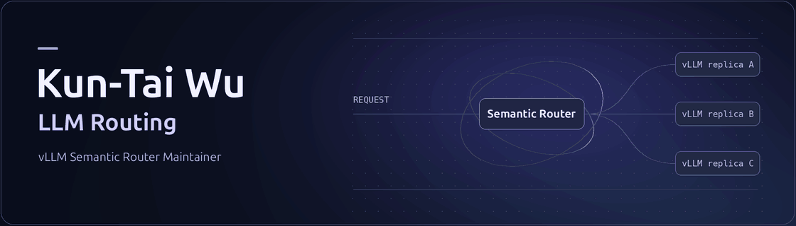

I maintain **vLLM Semantic Router**, where I work on request routing, replica load balancing, and the runtime behind routing decisions. At **Delta Electronics**, I lead development of **DeltaLLM v1.0**, an enterprise coding agent platform.

[vLLM Semantic Router](https://github.com/vllm-project/semantic-router) · [LinkedIn](https://www.linkedin.com/in/kun-tai-wu/)

### vLLM Semantic Router

**Routing & model selection**
- Built a per-decision selector that weighs model quality, latency, cost, and in-flight load against SLO limits. Added a way for agent harnesses to request a fresh routing decision within the same session. [#1953](https://github.com/vllm-project/semantic-router/pull/1953) · [#5617](https://github.com/vllm-project/semantic-router/pull/5617)
- Reduced keyword-matching latency from **501 to 17 ms/op** in a benchmark with a 6.7 KB Chinese prompt and 30 rules. [#1871](https://github.com/vllm-project/semantic-router/pull/1871)

**Model runtime & GPU deployment**
- Reduced host memory retained after loading FP8 d3-mini on NVIDIA GB10 from **3.98 to 0.40 GiB**. Added idle GPU allocator cache release after large requests on integrated GPUs. [#5258](https://github.com/vllm-project/semantic-router/pull/5258) · [#5892](https://github.com/vllm-project/semantic-router/pull/5892)
- Added a `linux/arm64` CUDA router image and enabled CUDA gated-delta fusion in builds without `causal-conv1d`. [#5615](https://github.com/vllm-project/semantic-router/pull/5615) · [#5694](https://github.com/vllm-project/semantic-router/pull/5694)

**Multimodal & model correctness**
- Added opt-in letterboxing for wide, short images. High-confidence localization errors on the d3-ultra crop evaluation fell from **50 to 10**. [#7274](https://github.com/vllm-project/semantic-router/pull/7274)
- Added image inputs to classification, evaluation, and embedding endpoints. Restored unit normalization after truncating multimodal embeddings. [#2104](https://github.com/vllm-project/semantic-router/pull/2104) · [#2188](https://github.com/vllm-project/semantic-router/pull/2188)

**Request path & caching**
- Restored Redis semantic-cache hits for streaming responses and propagated request cancellation through cache backends. [#2034](https://github.com/vllm-project/semantic-router/pull/2034) · [#2919](https://github.com/vllm-project/semantic-router/pull/2919)

### Current research

Comparing `load_aware` and `least_request` routing on live vLLM replicas. [#6871](https://github.com/vllm-project/semantic-router/issues/6871)

### Other open-source contributions

**llm-d Router**
- Fixed multimodal prefix-cache misses for salted vLLM requests when engine blocks are merged into larger router blocks. [#4138](https://github.com/llm-d/llm-d-router/pull/4138)
- Fixed speculative prefix-cache eviction so a shared entry survives until its last active request expires. [#3701](https://github.com/llm-d/llm-d-router/pull/3701)

My research background is in image restoration at National Chengchi University. I received an Academia Sinica Fellowship.
