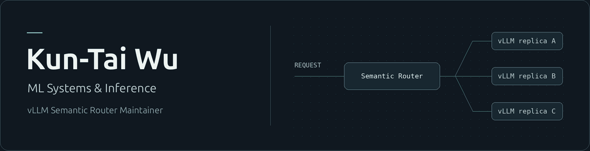

I maintain **vLLM Semantic Router**, where I work on GPU inference, ARM64 support, and model correctness. At **Delta Electronics**, I lead development of **DeltaLLM v1.0**, an enterprise coding agent platform.

[vLLM Semantic Router](https://github.com/vllm-project/semantic-router) · [LinkedIn](https://www.linkedin.com/in/kun-tai-wu/)

### Selected open-source work

- **FP8 model loading on NVIDIA GB10** — Reduced host memory retained after loading FP8 d3-mini from **3.98 GiB to 0.40 GiB** by staging quantized buffers one tensor at a time. [#5258](https://github.com/vllm-project/semantic-router/pull/5258)
- **CUDA runtime and ARM64** — Added a `linux/arm64` CUDA router image and enabled gated-delta fusion in builds without `causal-conv1d`. [#5615](https://github.com/vllm-project/semantic-router/pull/5615) · [#5694](https://github.com/vllm-project/semantic-router/pull/5694)
- **Visual grounding** — Added opt-in letterboxing for wide, short images. On the d3-ultra crop evaluation, high-confidence localization errors fell from **50 to 10**. [#7274](https://github.com/vllm-project/semantic-router/pull/7274)
- **Keyword matching** — Reduced benchmark latency from **501 ms/op to 17 ms/op** on a 6.7 KB Chinese prompt with 30 rules. [#1871](https://github.com/vllm-project/semantic-router/pull/1871)

### Current research

Comparing `load_aware` and `least_request` routing on live vLLM replicas. [#6871](https://github.com/vllm-project/semantic-router/issues/6871)

My research background is in image restoration at National Chengchi University. I received an Academia Sinica Fellowship.
