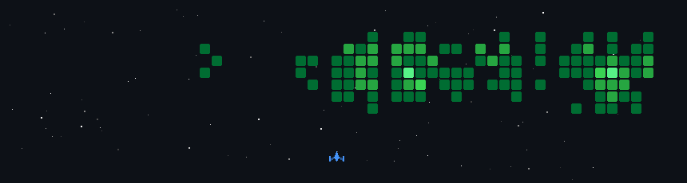

<!-- ============================================================
     WUKUNTAI-0211 / WUKUNTAI-0211 — profile README
     Banner: assets/banner-{light,dark}.svg, drawn by scripts/banner.py (SMIL animation).
     Section headers are static shields. Palette: #0b0d1a (ink) · #7c5cf0 (violet) · #5eead4 (teal).
     The space-shooter game at the bottom is redrawn daily by .github/workflows/game.yml.
     ============================================================ -->

  <picture>
    <source media="(prefers-color-scheme: dark)" srcset="assets/banner-dark.svg"/>
    
  </picture>

  
  
  

&nbsp;

I work on **semantic model routing**: deciding which model should serve each request, and running the decision models behind that choice fast on real GPUs. I'm a **maintainer of [vLLM Semantic Router](https://github.com/vllm-project/semantic-router)** (since Aug 2026) and an Associate Researcher at **Delta Electronics** in Taiwan. Before LLM systems, I worked on image restoration.

&nbsp;

| | Before | After | |
|---|---:|---:|---|
| Keyword matching, 6.7 KB Chinese prompt, 30 rules | 501 ms/op | **17 ms/op** | [#1871](https://github.com/vllm-project/semantic-router/pull/1871) |
| Recording a routing decision at 49,000 active sessions | 1.05 ms | **0.9 µs** | [#5610](https://github.com/vllm-project/semantic-router/pull/5610) |
| Host memory after loading FP8 d3-mini on NVIDIA GB10 | 3.98 GiB | **0.40 GiB** | [#5258](https://github.com/vllm-project/semantic-router/pull/5258) |
| High-confidence localization errors, d3-ultra crop eval | 50 | **10** | [#7274](https://github.com/vllm-project/semantic-router/pull/7274) |
| Redis semantic-cache hits on streaming responses | 0 / 10 | **restored** | [#2034](https://github.com/vllm-project/semantic-router/pull/2034) |

&nbsp;

<table width="100%">
<thead><tr>
  <th width="33%" align="left">Decision models on NVIDIA GB10</th>
  <th width="33%" align="left">vSR for OpenCode</th>
  <th width="34%" align="left">Delta Electronics</th>
</tr></thead>
<tbody><tr>
  <td valign="top">
    Making the router's decision models run well on GB10 (arm64): NVFP4 via cuBLAS 12.9, FP8 matmuls, and a fix for long forwards that reserve twice the memory they use.
      
    In review: <a href="https://github.com/vllm-project/semantic-router/pull/7152">#7152</a> · <a href="https://github.com/vllm-project/semantic-router/pull/7181">#7181</a> · next: <a href="https://github.com/vllm-project/semantic-router/issues/7275">#7275</a> · <a href="https://github.com/vllm-project/semantic-router/issues/5302">#5302</a>
  </td>
  <td valign="top">
    Bringing vSR, which runs the router's decision model inside the agent harness, to OpenCode as a native plugin: model routing for child sessions, guarded commands, redaction and answer checks.
      
    In review: <a href="https://github.com/vllm-project/semantic-router/pull/6688">#6688</a> · issue <a href="https://github.com/vllm-project/semantic-router/issues/6687">#6687</a>
  </td>
  <td valign="top">
    Built the company's first internal coding agent (ReAct on LangGraph, RAG memory, permission-gated tools). Training a cost-aware routing model on real agent trajectories.
      
    LiteLLM + Langfuse collection, labeled with LLM-as-judge
  </td>
</tr></tbody>
</table>

Paused: <code>load_aware</code> vs <code>least_request</code> needs two GPUs; single-GB10 results are in <a href="https://github.com/vllm-project/semantic-router/issues/6871">#6871</a>.

&nbsp;

Selected merged pull requests to [vllm-project/semantic-router](https://github.com/vllm-project/semantic-router):

| Area | What I shipped | Pull requests |
|---|---|---|
| **Model selection** | A per-decision selector that weighs quality, latency, cost, and in-flight load against SLO limits. Agent harnesses can ask for a fresh decision mid-session. | [#1953](https://github.com/vllm-project/semantic-router/pull/1953) · [#5617](https://github.com/vllm-project/semantic-router/pull/5617) |
| **GPU runtime** | Classifiers on NVIDIA GPUs (no silent CPU fallback), x86 and `linux/arm64` CUDA images, **65–240×** faster than CPU on an RTX 4090. Less host memory on load, idle allocator cache release on integrated GPUs, gated-delta fusion without `causal-conv1d`. | [#5615](https://github.com/vllm-project/semantic-router/pull/5615) · [#5258](https://github.com/vllm-project/semantic-router/pull/5258) · [#5892](https://github.com/vllm-project/semantic-router/pull/5892) · [#5694](https://github.com/vllm-project/semantic-router/pull/5694) |
| **Multimodal** | Image inputs for classification, evaluation, and embedding endpoints. Unit normalization after truncating embeddings. Letterboxing for wide images. | [#2104](https://github.com/vllm-project/semantic-router/pull/2104) · [#2188](https://github.com/vllm-project/semantic-router/pull/2188) · [#7274](https://github.com/vllm-project/semantic-router/pull/7274) |
| **Request path** | Session telemetry off the hot path. Streaming cache hits restored. Cancellation propagated through all six semantic-cache backends. | [#5610](https://github.com/vllm-project/semantic-router/pull/5610) · [#2034](https://github.com/vllm-project/semantic-router/pull/2034) · [#2919](https://github.com/vllm-project/semantic-router/pull/2919) |

Also in [llm-d Router](https://github.com/llm-d/llm-d-router): multimodal prefix-cache misses on salted requests ([#4138](https://github.com/llm-d/llm-d-router/pull/4138)) and early eviction of shared speculative entries ([#3701](https://github.com/llm-d/llm-d-router/pull/3701)).

<b><a href="https://github.com/vllm-project/semantic-router/pulls?q=is%3Apr+author%3AWUKUNTAI-0211+is%3Amerged">All merged PRs ↗</a></b>

&nbsp;

- **M.S. Computer Science**, National Chengchi University: multi-weather image restoration with dual-modal prompts. Academia Sinica Fellowship.
- ***Restore Anything Anywhere***, IEEE MMSP 2026.

&nbsp;

  
  
  
  
  
  
  
  
  
  

&nbsp;

  
  <code>request → classify → select → serve</code>

